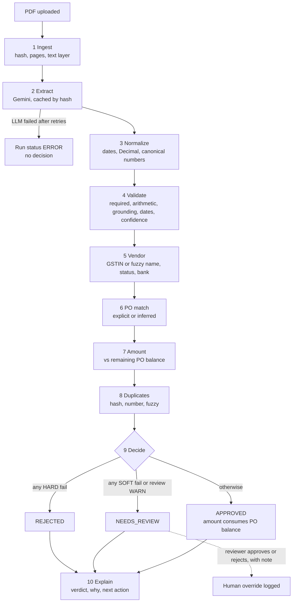

# Process map: AP Invoice Agent

A vendor invoice PDF goes in. A decision comes out (APPROVED, NEEDS_REVIEW or REJECTED) with
the reasons and the next action for the AP team. Every stage is visible live in the UI.

**The LLM extracts. Rules decide. Templates explain.** Only stage 2 calls an LLM. Stages 3 to 10
are deterministic Python, so the same input always gives the same decision.

Thresholds and severities are explained in `docs/assumptions.md` (referenced as A1, A2, ...).

## Flow

All stages always run, even after a HARD fail, so the reviewer sees the full picture. A stage
whose input is missing is SKIPPED with a reason (for example, Amount is SKIPPED when no PO matched).

## Stage events

Every stage emits a `StageEvent`: first `RUNNING`, then one of `PASS`, `WARN`, `FAIL`, `SKIPPED`.
The stage status is the worst outcome among its rules (FAIL > WARN > PASS). Each event carries
`started_at`, `ended_at`, a one-line `message` and a `payload` the UI renders. Every check inside a
stage stores a `RuleResult` (rule_id, outcome, severity, message, evidence).

## Stage by stage

### 1. Ingest (`stages/ingest.py`)

| | |
|---|---|
| Input | Uploaded PDF bytes, filename |
| Does | Saves the file, computes SHA-256, counts pages, extracts the text layer with pdfplumber, sets `is_scanned` (A8) |
| Output | `file_hash`, `page_count`, `is_scanned`, `pdf_text` (kept for grounding) |
| Payload | filename, size, pages, scanned yes/no, "seen before" yes/no |
| Rules | ING-SCANNED (INFO only, records the result). An earlier run with the same hash is recorded here and judged in stage 8 (DUP-HASH) |
| Fails when | File is not a readable PDF: run ERROR |

### 2. Extract (`stages/extract.py`, calls `llm/gemini.py`)

| | |
|---|---|
| Input | PDF bytes, file hash |
| Does | Looks up `data/fixtures/<hash>.json`. On a miss (and `LLM_MODE=live`) sends the PDF to Gemini with the strict schema, saves the result as a fixture. Retries with backoff on 429 |
| Output | For each field: value, `confidence` (0 to 1), `source_text`. Fields: vendor_name, vendor_gstin, invoice_number, invoice_date, due_date, po_reference, currency, line_items[description, qty, unit_price, amount], subtotal, taxes[type, rate, amount], tax_inclusive, total, bank_account, ifsc |
| Payload | Extracted fields table with confidence bars, source (fixture cache or live), model name, latency |
| Fails when | LLM error after retries, quota exhausted, or schema invalid: stage FAIL, run ERROR, no decision (A10) |

### 3. Normalize (`stages/normalize.py`)

| | |
|---|---|
| Input | Raw extraction |
| Does | Dates to ISO `YYYY-MM-DD`. Money to `Decimal` with 2 places (A2). Canonical invoice number and PO reference (A11). Uppercases GSTIN and IFSC, strips spaces from bank account |
| Output | `normalized_json` used by every later stage |
| Payload | Before and after for each changed field |
| Rules | NORM-PARSE: WARN if a value could not be parsed (for example an unreadable date); that field is then treated as missing |

### 4. Validate (`stages/validate.py`)

| Rule | Checks | Outcome if broken | Severity |
|---|---|---|---|
| VAL-REQUIRED | vendor_name, invoice_number, invoice_date, total are present (A12) | FAIL | SOFT |
| VAL-CONFIDENCE | each of those four has confidence ≥ 0.70 | WARN, review | SOFT |
| VAL-GROUNDING | total and invoice number appear in the PDF text (A13). SKIPPED if scanned | WARN, review | SOFT |
| VAL-ARITH-LINES | sum(line amounts) = subtotal ±₹1, or = total if tax inclusive (A14) | FAIL | SOFT |
| VAL-ARITH-TOTAL | subtotal + taxes = total ±₹1 (tax exclusive only) | FAIL | SOFT |
| VAL-DATE-FUTURE | invoice date not after today, IST (A3, A15) | FAIL | SOFT |
| VAL-DATE-STALE | invoice date within 180 days | WARN, review | SOFT |
| VAL-DUE-DATE | due date not before invoice date | WARN | INFO |
| VAL-GSTIN-FORMAT | GSTIN matches the format (A5), if present | WARN, review | SOFT |
| VAL-CURRENCY | currency is INR (A1) | FAIL | SOFT |

Payload: rule checklist with evidence (for example "lines ₹1,00,000.00 vs subtotal ₹1,00,000.00, diff ₹0.00").

### 5. Vendor check (`stages/vendor.py`)

| Rule | Checks | Outcome if broken | Severity |
|---|---|---|---|
| VEN-MATCH | GSTIN exact match, else fuzzy name or alias ≥ 90 (A16) | FAIL | SOFT |
| VEN-GSTIN | if matched by name, invoice GSTIN equals master GSTIN (A17) | WARN, review | SOFT |
| VEN-STATUS | matched vendor is APPROVED, not BLOCKED (A18) | FAIL | HARD |
| VEN-BANK | invoice bank account and IFSC equal the master (A19) | FAIL, FRAUD_RISK | SOFT |
| VEN-BANK-MISSING | invoice shows bank details | WARN | INFO |

Payload: matched vendor card (how matched, score), master vs invoice bank details side by side
with masked account numbers. If no vendor matched, VEN-STATUS and VEN-BANK are SKIPPED.

### 6. PO match (`stages/po_match.py`)

| Path | Rule | Result |
|---|---|---|
| Invoice has `po_reference` | PO-EXPLICIT | PO exists, same vendor, OPEN: PASS. Otherwise FAIL SOFT, no PO (A20) |
| No `po_reference`, vendor known | PO-INFER | Score the vendor's OPEN POs (A21). Clear winner: WARN, PO_INFERRED, review. No clear winner: FAIL SOFT, no PO |
| No `po_reference`, vendor unknown | PO-INFER | FAIL SOFT, "cannot infer PO without a known vendor" |

Payload: PO card (PO number, total, consumed, remaining, this invoice) and, for inference, the
candidate list with scores.

### 7. Amount check (implemented in `stages/po_match.py`, own StageEvent)

| Rule | Checks | Outcome if broken | Severity |
|---|---|---|---|
| AMT-REMAINING | total ≤ remaining + max(2% of remaining, ₹500) (A22, A23) | FAIL, OVER_PO, exact overage in message | SOFT |
| AMT-UNIT-PRICE | each paired line within 5% of the PO unit price (A24) | WARN | INFO |

SKIPPED when no PO matched. Payload: PO total, consumed, remaining, this invoice, tolerance,
overage; per line variance table.

### 8. Duplicate check (`stages/duplicates.py`)

| Rule | Checks | Outcome if broken | Severity |
|---|---|---|---|
| DUP-HASH | no earlier run has the same file hash | FAIL, DUPLICATE | HARD |
| DUP-NUMBER | no earlier run for the same vendor has the same canonical invoice number | FAIL, DUPLICATE | HARD |
| DUP-FUZZY | no earlier run for the same vendor with total ±₹1, date ±7 days, number similarity ≥ 85 | FAIL, DUPLICATE | HARD |

Which earlier runs count and what "same vendor" means: A26. Payload: link to the original run
and a side by side of the matching fields.

### 9. Decide (`stages/decide.py`)

No LLM. Reads all RuleResults of the run.

| Condition (checked in order) | Decision |
|---|---|
| Any rule FAIL with severity HARD | REJECTED |
| Any rule FAIL with severity SOFT, or any WARN marked as a review reason | NEEDS_REVIEW |
| Otherwise | APPROVED; the total now counts as consumed on the matched PO |

Flags (A29):

| Flag | Raised by |
|---|---|
| DUPLICATE | DUP-HASH, DUP-NUMBER, DUP-FUZZY |
| FRAUD_RISK | VEN-BANK |
| OVER_PO | AMT-REMAINING |
| PO_INFERRED | PO-INFER (clear winner) |
| LOW_CONFIDENCE | VAL-REQUIRED, VAL-CONFIDENCE, VAL-GROUNDING |

Payload: decision, flags, counts of HARD / SOFT / review WARN results.

### 10. Explain (`stages/explain.py`)

No LLM. Template per rule outcome (A31).

| Part | Built from |
|---|---|
| Verdict (one line) | Decision plus the most severe reason, for example "Needs review: invoice exceeds remaining PO balance" |
| Why (bullets) | One sentence per FAIL and review WARN, most severe first, with the numbers from evidence |
| Next action | Fixed text per rule, for example VAL-REQUIRED (invoice_number): "Ask vendor for the invoice number"; VEN-BANK: "Verify the bank change by calling the vendor on the number on file, not the one on the invoice"; AMT-REMAINING: "Ask procurement to amend the PO or ask the vendor for a revised invoice"; DUP-*: "Do not pay. Compare with the original run" |

For APPROVED runs the verdict states the PO and remaining balance after this invoice.

## Human review

After Decide, a reviewer can APPROVE or REJECT any run with a note (A30). The automated decision
is never overwritten; the override and note are stored next to it. A reviewer approval of a
NEEDS_REVIEW run consumes PO balance (A22).

## Test scenarios through the map

| ID | Key path through the stages | Expected |
|---|---|---|
| HP-1 | All rules PASS. PO-EXPLICIT PASS, AMT-REMAINING PASS | APPROVED |
| HP-2 | Tax inclusive arithmetic (A14). Total 1.5% over remaining, inside max(2%, ₹500): AMT-REMAINING PASS "within tolerance" | APPROVED |
| EC-1 | Split PO ₹3,00,000. A ₹1,20,000 and B ₹1,20,000 approve, remaining ₹60,000. C ₹90,000 vs tolerance ₹1,200: AMT-REMAINING FAIL SOFT "exceeds remaining ₹60,000.00 by ₹30,000.00" | C: NEEDS_REVIEW, OVER_PO |
| EC-2 | HP-1 re-laid out, `INV/2026/0142` vs `INV-2026-142`, new hash. Canonical numbers equal: DUP-NUMBER FAIL HARD (DUP-FUZZY also fires) | REJECTED, DUPLICATE, links HP-1 run |
| EC-3 | Scanned: grounding SKIPPED. No invoice number: VAL-REQUIRED FAIL SOFT. Low confidence: VAL-CONFIDENCE WARN. No PO: PO-INFER clear winner WARN. Next action lists each missing field | NEEDS_REVIEW, LOW_CONFIDENCE, PO_INFERRED |
| EC-4 | Approved vendor, valid PO, bank account differs: VEN-BANK FAIL SOFT | NEEDS_REVIEW, FRAUD_RISK, "verify by phone on file" |

Run order: HP-1, HP-2, EC-1 (A, B, C), EC-2, EC-3, EC-4. EC-1 needs A and B approved first; EC-2
needs HP-1 approved first. Exact steps go in `docs/demo-script.md` (Layer 7).
